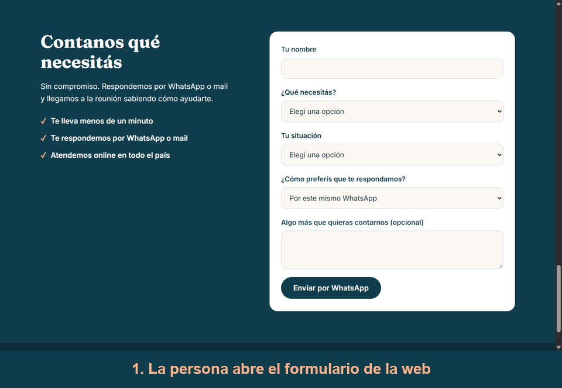

# Prácticas del módulo de Claude Code: Triple A

Tres webs para negocios distintos que armé como práctica del módulo de Claude Code de la comunidad Triple A, en 2026. Son casos ficticios, pero los trabajé como encargos reales: ordené lo que pedía cada cliente, tomé las decisiones de estructura, diseño y tono, y dirigí a Claude Code, que escribió el código. Al final sumé un proyecto integrador: que Claude, conectado a Gmail, deje borradores de respuesta a las consultas de una de las webs.

## Los tres casos

| Caso | Rubro | Problema que resuelve | Demo | Performance en celular |
|---|---|---|---|---|
| [Estudio Verde](web-estudio-verde/README.md) | Arquitectura y paisajismo | Las consultas llegaban dispersas (mail, Instagram, teléfono). Ahora hay un solo camino: WhatsApp o mail. | [Ver web](https://web-estudio-verde.vercel.app) | 92 |
| [El Fogón de Don Nino](web-fogon-nino/README.md) | Parrilla de barrio | Mucha información para mostrar y precios que cambian seguido. La carta sale de una planilla que edita el dueño. | [Ver web](https://web-fogon-nino.vercel.app) | 97 |
| [Estudio Ferreyra & Asociados](web-ferreyra/README.md) | Estudio contable | Los recomendados no encontraban nada serio al buscarlos. La web transmite confianza y explica los servicios sin asustar. | [Ver web](https://web-ferreyra-asociados.vercel.app) | 90 |

Puntajes de Performance de Lighthouse, medidos en modo celular con Chrome sobre los links publicados. Las tres webs sacaron 100 en Accesibilidad, Buenas prácticas y SEO.

Los datos de contacto, las matrículas, las direcciones y varios textos son de ejemplo, y las fotos son de relleno. Cada README lo aclara.

## Proyecto integrador: borradores de respuesta por mail

Sobre la web de Ferreyra: el formulario ahora permite que la persona elija que le respondan por mail. Con la consulta, Claude usa un Skill con el tono del estudio y el MCP de Gmail para dejar un **borrador** de respuesta. Claude no envía nada: el dueño lo revisa y decide si lo manda.

El detalle (las tres piezas, un borrador de ejemplo y los límites) está en el [README de Ferreyra](web-ferreyra/README.md#integrador-borradores-de-respuesta-por-mail-con-claude-y-mcp).

## Cómo trabajé

El mismo método en los tres casos:

1. **Ordenar antes de pedir.** Leía la consigna y definía el problema número uno, qué sí y qué no va en la web, y las secciones por importancia, antes de escribirle algo a Claude.
2. **Decidir yo.** Para cada decisión de diseño o de texto, Claude proponía opciones y yo elegía.
3. **Cambios de a uno.** Cada cambio lo aceptaba o lo ajustaba antes de pasar al siguiente.
4. **Verificar con los ojos.** Lo probaba en el navegador y en celular simulado, y repasaba la lista de autochecks de la consigna.
5. **Guardar y publicar.** Commits agrupados por tarea y deploy en Vercel conectado a este repo.
6. **Documentar.** Un README por caso, con las decisiones y qué mejoraría.

## Qué aprendí

- **El loop: pedir, construir, verificar, ajustar.** No existe el prompt perfecto: el resultado se acerca en cada vuelta. Por eso trabajé de a un cambio, y Estudio Verde tuvo más de quince.
- **Verificar siempre: "se ve bien" no es "está bien".** Claude suena seguro aunque se equivoque. Al revisar encontré errores reales: el formulario abría WhatsApp dos veces, un dominio que yo creía libre era de otra persona y un mapa no cargaba.
- **Ordenar y estructurar el pedido antes de escribirlo.** Un buen pedido tiene rol, contexto, orden de ejecución, formato y autopreguntas. En la práctica, convertía las notas del cliente en decisiones antes de pedir nada.
- **Dar solo el contexto justo y cuidar la conversación.** El contexto de Claude tiene un límite, y una conversación larga y mezclada rinde peor. Una conversación para un tema, `/clear` para empezar limpio y `/compact` para seguir liviano. Para no perder el hilo entre sesiones usé un archivo de progreso.
- **Skills: enseñarle a Claude a hacer algo a mi manera una sola vez.** Un Skill es un archivo con rol, contexto, reglas y formato de salida. Usé uno para auditar y documentar cada repo igual, y otro para que las respuestas de Ferreyra suenen siempre como el estudio, sin explicarle el tono cada vez.
- **MCP: darle a Claude llaves a herramientas de afuera.** Sirve para conectarlo con Gmail, calendario o Drive. En Fogón la carta sale de una planilla de Google, y vi hasta dónde llega la conexión: puede leerla, pero no editar sus celdas. En el integrador lo conecté a Gmail para que cree borradores. Aprendí que la IA propone y yo dispongo: un mail enviado no se deshace, así que reviso cada borrador antes de mandarlo. Y que el permiso del conector no alcanza como barrera: que no envíe también depende del Skill y de mi revisión.
- **Medir antes de mejorar.** Fogón sacó 71 en Lighthouse. Busqué qué pesaba, arreglé dos cosas (cargar en diferido las fotos que no se ven y pedir antes el fondo de la portada) y subió a 97.
- **Elegir el modelo según la tarea.** Haiku para lo simple y repetitivo, Sonnet casi siempre y Opus para lo difícil. No conviene usar el más caro por las dudas.
