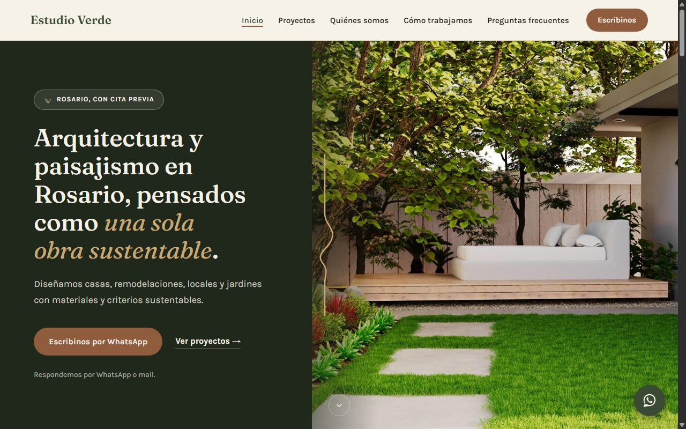
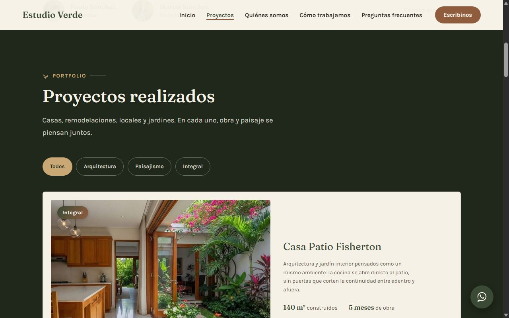
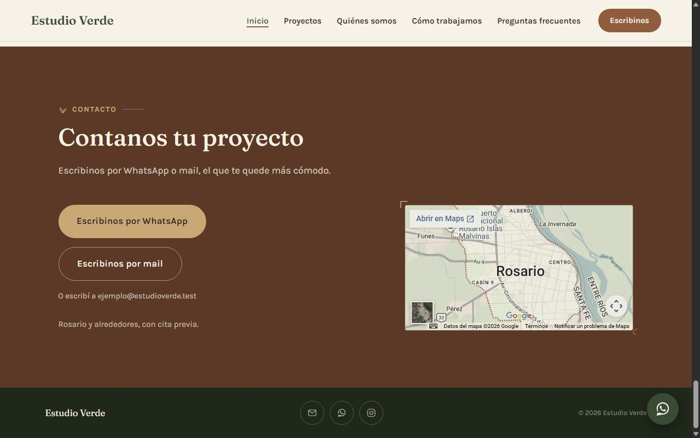

# Estudio Verde

Web de una sola página para un estudio de arquitectura y paisajismo de Rosario. Es un caso ficticio que armé como práctica del módulo de Claude Code de la comunidad Triple A, en 2026. Lo trabajé como un encargo real: ordené lo que pidió el cliente, tomé las decisiones de estructura y diseño, y dirigí a Claude Code, que escribió el código.

## Problema que resuelve

Una arquitecta y un paisajista que trabajan juntos recibían consultas por mail, por Instagram y por el teléfono de uno de ellos, y varias se perdían. Querían un solo lugar ordenado donde la gente los pudiera contactar, y que la web se sintiera cálida y cercana, no corporativa.

El desafío fue que el visitante pasara de mirar fotos a escribir, respetando lo que el cliente pidió que no estuviera: sin precios y sin dirección exacta. En el estudio atienden con cita previa, así que la ubicación dice "Rosario, con cita previa".

## Demo

https://web-estudio-verde.vercel.app

Los datos de contacto son de ejemplo: el WhatsApp y el mail no existen, y el botón de Instagram lleva a instagram.com. Los nombres de los proyectos, los metros cuadrados, las duraciones y las bios también son inventados.

Las fotos son de relleno. Siete son de Pexels. Las otras tres (`proyecto-4`, `proyecto-5` y `proyecto-8`) son de origen sin verificar, y en un proyecto real no las usaría.

## Tecnologías

- HTML: estructura de la página, en un solo archivo.
- CSS: estilos y diseño adaptable a celular, sin framework. Los colores están definidos como variables.
- JavaScript sin librerías: menú del celular, filtros de proyectos, botón "Ver más proyectos" en celular, visor de fotos y los links de contacto.
- Google Fonts (Fraunces y Karla): tipografías.
- Google Maps embebido: mapa de la zona de trabajo.
- Vercel: publica la web desde este repo.
- Claude Code: escribió el código a partir de las decisiones que fui definiendo.

## Cómo funciona

Es una página estática: no hay build ni dependencias.

Las decisiones que tomé y por qué:

- **WhatsApp como acción principal y sin formulario.** El problema del cliente era que las consultas se dispersaban. Un formulario sumaba un tercer canal que no pidió, y el que abría el programa de correo fallaba si el visitante no tenía uno configurado. El botón abre el chat con el mensaje ya escrito, y el mail queda como opción secundaria.
- **Datos de contacto en un solo lugar.** Están en un objeto al final de `script.js`. Para publicar con datos reales se cambian ahí, una vez.
- **Proyectos justo después del primer pantallazo.** El cliente quería que la web "entre por los ojos", y antes había dos secciones de texto antes de ver una foto.
- **Las caras del equipo, cerca del inicio.** Sin testimonios ni matrícula que mostrar, ver a las dos personas que atienden era la forma honesta de dar confianza.
- **En celular, el texto va antes que la foto, y solo se ven 3 proyectos.** En un celular de 375 píxeles el botón de WhatsApp quedaba fuera del primer pantallazo, y 8 proyectos en una columna alargaban mucho la página antes de llegar al contacto.
- **Textos cortos y directos.** Reescribí todo el copy para que suene cercano, y saqué promesas que el cliente no había dicho, como un plazo de respuesta.
- **Fotos más livianas.** Las siete fotos nuevas pasaron de unos 20 MB a unos 2 MB, con la misma calidad a simple vista.
- **Sin framework.** Es una página sola, y agregar uno hubiera sumado complejidad sin ganar nada.
- **Publicada desde el repo, con su propia configuración.** El repo tiene varias webs, así que el proyecto de Vercel apunta a la carpeta `web-estudio-verde` como Root Directory, con el framework en "Other".

## Cómo correrlo

No se corre: es una página estática y se ve en el link publicado, https://web-estudio-verde.vercel.app.

## Qué aprendí y qué mejoraría

**Qué aprendí**

- Ordenar las notas del cliente en decisiones antes de pedirle algo a Claude. Con las decisiones claras, pedir cambios fue mucho más preciso.
- Que la conversión va más allá del diseño: una acción principal visible en el primer pantallazo, botones con textos concretos y menos pasos para contactar. Detecté varios problemas mirando la web en un celular simulado, no solo en la compu.
- Qué es un deploy y para qué sirve el Root Directory. Mi primer deploy dio 404: Vercel buscaba el `index.html` en la raíz del repo y la web está en una subcarpeta.

**Qué mejoraría**

- Reemplazar las fotos de relleno por obras reales del cliente, y confirmar con él los metros cuadrados, las duraciones y las bios.
- Poner los datos de contacto reales: WhatsApp, mail e Instagram.
- Sumar testimonios y la matrícula profesional, cuando existan.
- Medir la velocidad con Lighthouse sobre la web publicada y mejorar lo que salga.
