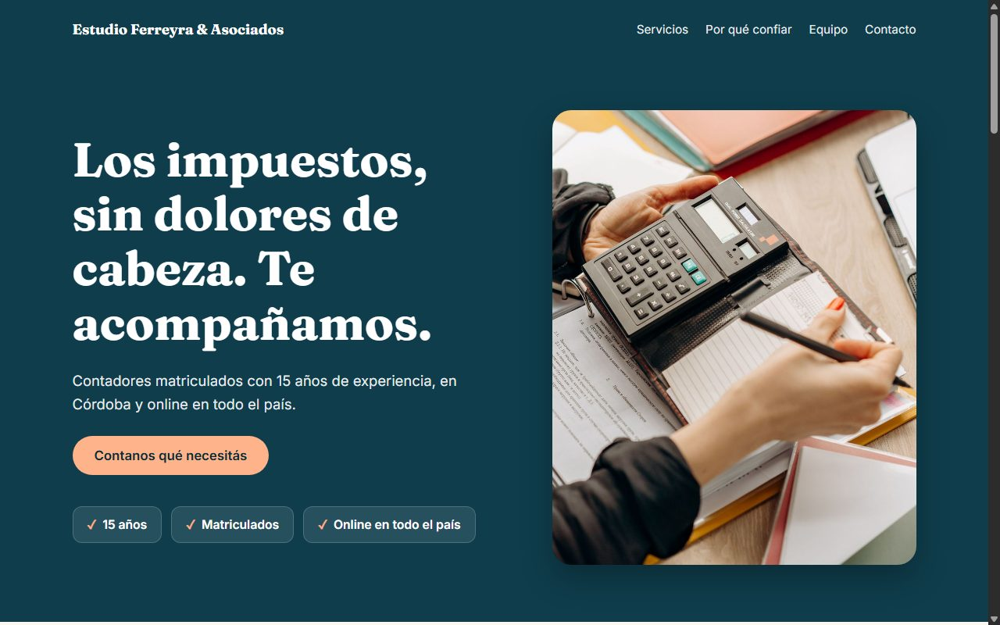
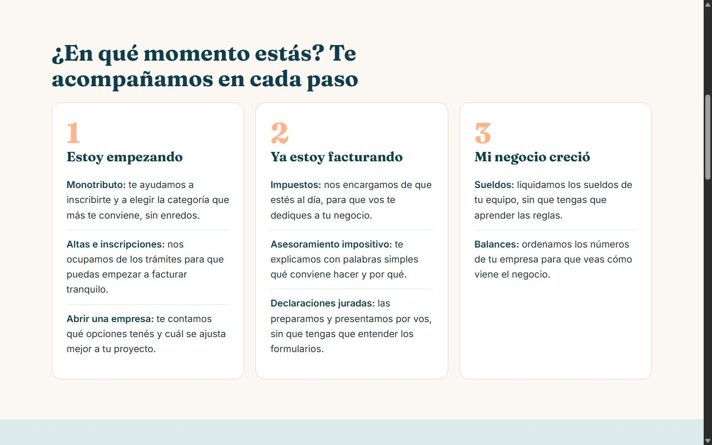
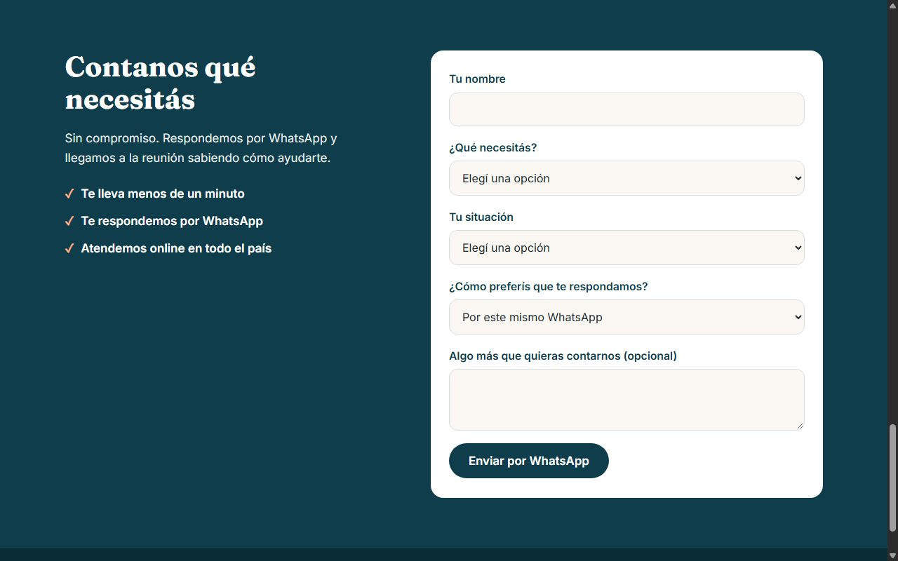
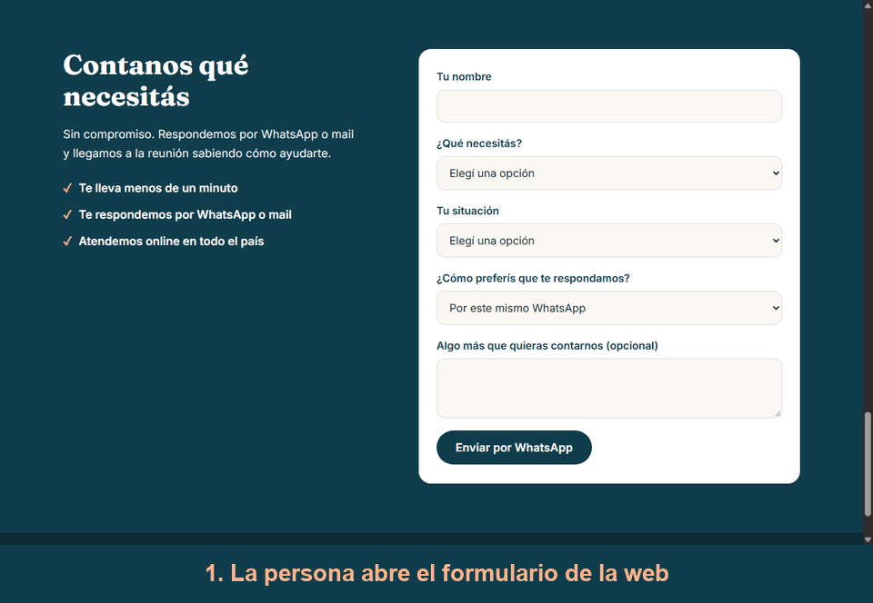

# Estudio Ferreyra & Asociados

Web de un estudio contable de Córdoba con 15 años de experiencia. Es un caso ficticio que armé como práctica del módulo de Claude Code de la comunidad Triple A, en 2026. Lo trabajé como un encargo real: ordené lo que pidió la cliente, tomé las decisiones de estructura, diseño y tono, y dirigí a Claude Code, que escribió el código.

## Problema que resuelve

Al estudio lo recomiendan de boca en boca, pero cuando el recomendado los busca en internet "no encuentra nada serio y desconfía". La web tenía que respaldar esa recomendación y, a la vez, atraer a emprendedores jóvenes que le tienen miedo a los impuestos.

El desafío de este caso fue la tensión entre seriedad y cercanía: transmitir confianza sin caer en lo gris y acartonado, y explicar servicios técnicos sin asustar.

## Demo

https://web-ferreyra-asociados.vercel.app

Los datos son de ejemplo: el WhatsApp (5490000000000) y el mail (ejemplo@ferreyra.test) no existen, y las matrículas y la dirección (Av. Colón 200) son inventadas, aunque el mapa muestra esa dirección real. Las frases de cada socio, los puntos junto al formulario ("Te lleva menos de un minuto") y la descripción del equipo de tres personas no vienen de las notas del cliente: son ficción del caso.

Las fotos son de relleno y de personas ajenas al caso: vienen de Pexels y otras fuentes, y no verifiqué la licencia de todas. En un proyecto real las reemplazaría por las del estudio.

## Tecnologías

- HTML: estructura de la página, en un solo archivo.
- CSS: estilos y diseño adaptable a celular, sin framework. Los colores están definidos como variables.
- JavaScript sin build: el formulario que arma el mensaje y lo manda a WhatsApp o por mail, y el menú desplegable del celular.
- Google Fonts (Fraunces e Inter): tipografías.
- Google Maps embebido: mapa de la oficina.
- Vercel: publica la web desde este repo.
- Claude Code: escribió el código a partir de las decisiones que fui definiendo.

## Cómo funciona

Es una página estática: no hay build ni dependencias que instalar.

Las decisiones que tomé y por qué:

- **Los servicios, agrupados por el momento del cliente.** El estudio tiró ocho servicios. En vez de una lista técnica, los ordené en tres grupos: "Estoy empezando", "Ya estoy facturando" y "Mi negocio creció". Cada persona se reconoce en uno.
- **Cada servicio, en una frase de todos los días.** "Declaraciones juradas" se explica como "las preparamos y presentamos por vos, sin que tengas que entender los formularios". Es la misma información, pero tranquiliza en vez de asustar.
- **Confianza visible desde el primer pantallazo.** Debajo del título van tres datos: 15 años, matriculados y online en todo el país. Las matrículas de los dos socios aparecen en la sección de confianza y en el pie, porque la cliente quería que se vieran.
- **Un formulario que manda la consulta a WhatsApp o por mail.** La cliente quería una primera consulta ordenada. El formulario pregunta nombre, qué necesita, en qué situación está y cómo prefiere que le respondan, y arma el mensaje con esos datos en líneas separadas. Si la persona elige que le respondan por mail, aparece un campo para su mail y el mensaje se abre en su programa de correo, dirigido al estudio. El número y el mail están en `script.js`, en un solo lugar.
- **Sin precios.** "Depende de cada caso, primero hay que conocer al cliente."
- **Azul petróleo con un acento durazno y títulos con serif.** Sobrio, pero no aburrido: tomé la referencia de los bancos y las fintech que le gustaron a la cliente, con un toque más cálido.
- **Sin promesas inventadas.** Revisé los textos como si fuera un emprendedor de 25 años y saqué dos frases que el cliente no había dicho, como "te avisamos antes de cada vencimiento".
- **Foto en el inicio, que ocupa toda la pantalla.** Para que no quedara un color plano.
- **Menú de celular desplegable.** En computadora se ve la lista de secciones.
- **Vista previa al compartir el link y favicon.** Para que el link se vea bien en WhatsApp.
- **Publicada desde el repo, con su propia configuración.** El repo tiene varias webs, así que el proyecto de Vercel apunta a la carpeta `web-ferreyra` como Root Directory.

## Integrador: borradores de respuesta por mail con Claude y MCP

Proyecto final del curso: responder una consulta sea casi automático, sin que Claude mande nada solo. La IA propone y el dueño dispone.

**Cómo funciona el flujo**

1. La persona completa el formulario y elige que le respondan por mail. Su consulta llega al estudio con su mail.
2. Le paso la consulta a Claude. Claude carga el Skill del estudio y, con el MCP de Gmail, deja un **borrador** de respuesta en la carpeta Borradores.
3. El dueño revisa el borrador y decide si lo manda.

**Las tres piezas**

- **MCP de Gmail:** un puente estandarizado que le permite a Claude usar una herramienta externa, acá el correo, con permisos acotados y sin copiar y pegar. Claude crea el borrador directo en Gmail.
- **Skill [`respuesta-ferreyra`](../.claude/skills/respuesta-ferreyra/SKILL.md):** le dice a Claude cómo suena el estudio (profesional y tranquilizador, con voseo), cómo se arma el mail y qué no puede decir (precios ni promesas). Así no se lo explico en cada consulta.
- **Borrador, no envío:** un mail enviado no se deshace y sale con el nombre del estudio. Con el borrador se revisan el tono, los datos y las promesas antes de mandarlo.

**Un borrador de ejemplo.** Con una consulta inventada (Lucas, que vende ropa por Instagram y pregunta por el monotributo), Claude dejó:

> **Asunto:** Re: Monotributo
>
> Hola, Lucas:
>
> Quedate tranquilo: es una de las consultas que más recibimos y tiene solución.
>
> Entendemos que recién estás empezando a vender ropa por Instagram y no sabés si tenés que anotarte en algo. El monotributo es un régimen simple para quienes recién empiezan: una cuota mensual en lugar de varios trámites por separado. Cuál te corresponde en tu caso y cuánto sería, lo vemos mejor en persona.
>
> ¿Coordinamos una reunión corta, por videollamada o en nuestra oficina de Córdoba? Respondé este mail con los días y horarios que te queden cómodos y la cerramos.
>
> Un saludo,
> Estudio Ferreyra y Asociados

## Cómo correrlo

No se corre: es una página estática y se ve en el link publicado, https://web-ferreyra-asociados.vercel.app.

## Qué aprendí y qué mejoraría

**Qué aprendí**

- Agrupar muchos servicios por el momento del cliente. En vez de una lista técnica de ocho ítems, tres grupos que hablan de la persona (estoy empezando, ya estoy facturando, mi negocio creció) hicieron que no se sintiera abrumador.
- Hacer un formulario que arma el mensaje y lo envía a WhatsApp o por mail. La consulta llega ordenada, con lo que necesita la persona y su situación, y no hace falta un servidor. Al probarlo detecté un error: WhatsApp se abría dos veces, en una pestaña nueva y en la misma. Lo arreglé.
- Que la confianza se muestra, no se promete. Matrículas, años y atención online a la vista desde el primer pantallazo, y sacar promesas que la cliente no había dicho.

**Qué mejoraría**

- Reemplazar las fotos de relleno por las del estudio.
- Poner los datos reales: WhatsApp, matrículas, dirección y mail.
- Agregar testimonios de clientes reales, que acá no incluí para no inventarlos.
- Medir la velocidad con Lighthouse sobre la web publicada y mejorar lo que salga.
